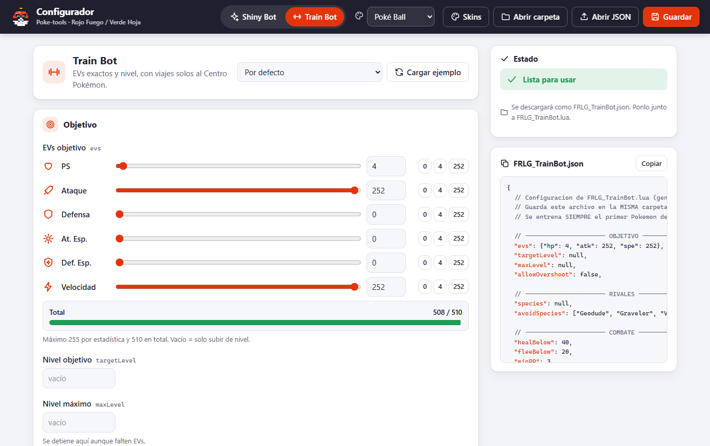

# Configurator

A visual editor for the bots' JSON files. Open `index.html` with a double click: it runs
locally in the browser, with no install and no internet connection. The interface is in
Spanish, like everything the player sees.



## What it does

- **Forms for every option** of the Shiny Bot and the Train Bot, grouped by topic, with
  short help. Options that don't apply to the chosen mode are hidden.
- **Validation as you type**, with the same rules the bots apply when they load the JSON,
  plus warnings for configs that load but won't do what you expect (e.g. a species that
  gives EVs outside your goal). Click an issue to jump to its field.
- **Smart inputs:** mode cards, nature/species/move pickers with autocomplete (Spanish
  nature names are accepted), IV ranges, EV sliders with the 510 total, EV-yield badges on
  each species, a ready-made route picker that also sets the healing mode, and a random
  ntfy topic generator.
- **Examples:** load the default config or the ready-made training examples.
- **Live preview** of the exact commented JSON that will be saved.
- **Saving:** in Edge or Chrome, *Abrir carpeta* opens the bot's folder and *Guardar*
  writes `FRLG_ShinyBot.json` / `FRLG_TrainBot.json` straight into it. Other browsers
  download the file. *Abrir JSON* (or drag and drop) loads an existing file.
- **Skins:** five built-in themes and support for your own (see [skins/](skins/README.md)).
- Your work in progress is kept in the browser between visits.

Deep links: `index.html#trainbot` opens the Train Bot tab, `index.html?skin=noche` picks a skin.

## Files

| Path | What it is |
|---|---|
| `index.html` | The page |
| `css/app.css` | Styles; every color, font and radius is a CSS variable that skins override |
| `js/data.js` | **Generated** game data (natures, species, moves, EV yields, presets) |
| `js/schema.js` | Every bot option: type, default, Spanish label and help |
| `js/core.js` | Parse, normalize, validate and serialize configs (no DOM; tested in Node) |
| `js/sprites.js` | Our original icons and the pixel-art mascot |
| `js/skin.js` | Skin registry, sanitizer and import/export |
| `js/app.js` | The UI |
| `skins/*.js` | Built-in skins |
| `tools/build_data.py` | Regenerates `js/data.js` from the bots' Lua tables and example configs |
| `tests/` | Unit, integration and UI smoke tests |

## Development

- After changing the bots' tables or example configs, regenerate the data:
  `python configurator/tools/build_data.py`. CI fails if `js/data.js` is stale.
- When a bot gains or loses an option, update `js/schema.js`: the parity test fails otherwise.
- Tests:
  ```
  node --test configurator/tests/core.test.js          # core logic
  python configurator/tests/test_bots_accept.py        # schema parity + the real bots accept the exported JSON
  ```
  The UI smoke test (`tests/ui-smoke.html`) drives the page in headless Chrome/Edge; the
  command is at the top of the file.

Design decisions: [ADR-0009](../docs/00-project/adr/0009-local-web-configurator.md) and
[ADR-0010](../docs/00-project/adr/0010-skins-as-sanitized-data.md).
