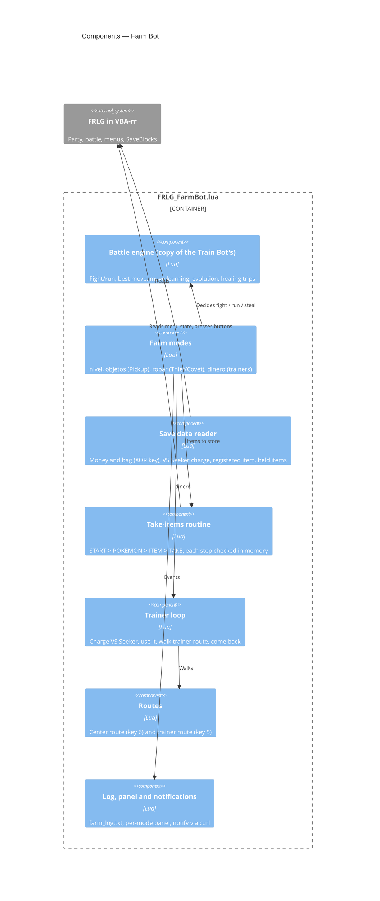

# C4 — Farm Bot components

> **AI-DLC phase:** `02-design`  ·  Level 3: inside `FRLG_FarmBot.lua`.

**Notes**
- Menu addresses come from pret's symbol maps for the four USA builds; on other versions the
  take-items routine falls back to pausing ([ADR-0011](../00-project/adr/0011-farm-bot-forked-from-train-bot.md)).
