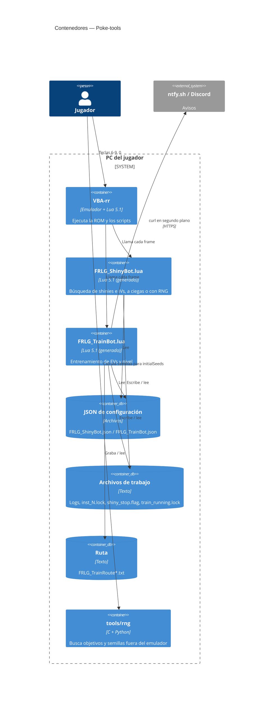

# C4 — Contenedores

> **Fase AI-DLC:** `02-design`  ·  Nivel 2: las piezas que se ejecutan o se guardan.

**Notas**
- Solo se carga **un** script a la vez por ventana de Lua. El Shiny Bot admite varias
  ventanas coordinadas por archivos; el Train Bot solo una.
- Los `.lua` se generan desde `src/` con `build.py` ([ADR-0002](../00-project/adr/0002-script-unico-generado.md)).
