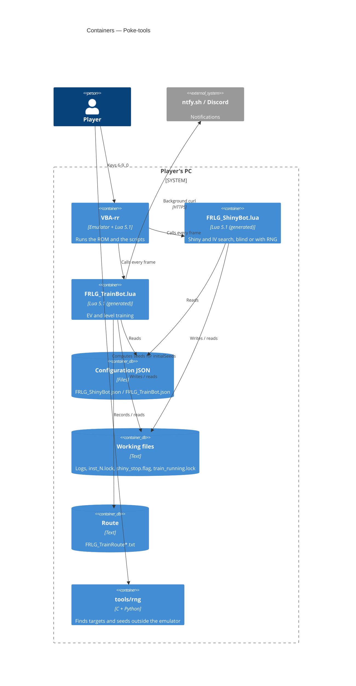

# C4 — Containers

> **AI-DLC phase:** `02-design`  ·  Level 2: the pieces that run or are stored.

**Notes**
- Only **one** script is loaded per Lua window. The Shiny Bot allows several windows
  coordinated through files; the Train Bot only one.
- The `.lua` files are generated from `src/` with `build.py` ([ADR-0002](../00-project/adr/0002-single-generated-script.md)).
