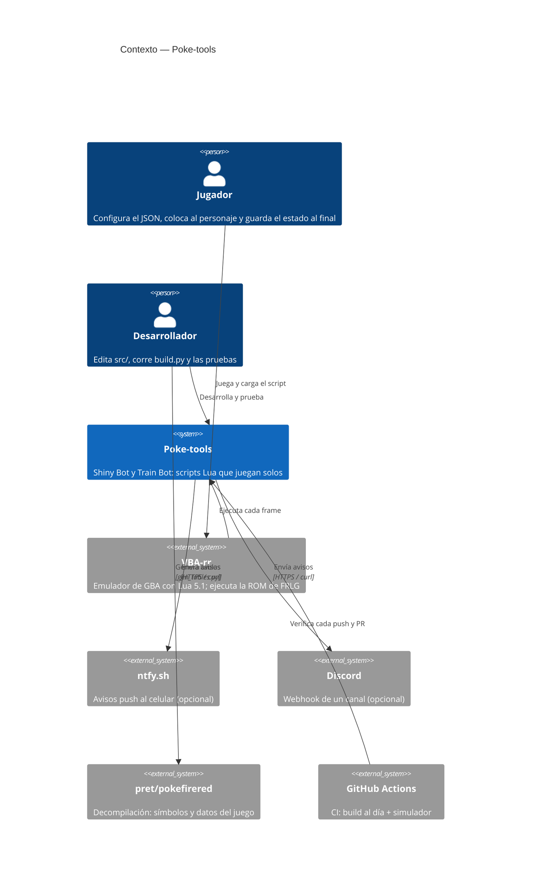

# C4 — Contexto

> **Fase AI-DLC:** `02-design`  ·  Nivel 1: el sistema en su entorno.

**Notas**
- La ROM y las partidas son del jugador y nunca entran al repositorio.
- ntfy.sh y Discord solo se usan si el Train Bot tiene `notify` configurado.
