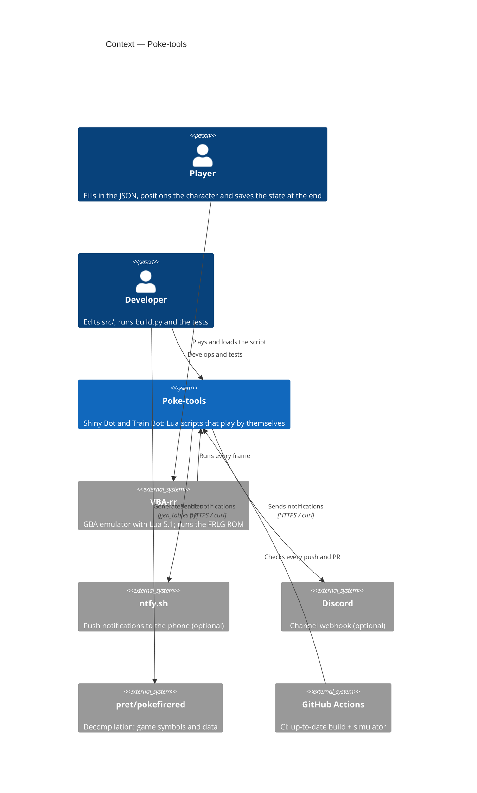

# C4 — Context

> **AI-DLC phase:** `02-design`  ·  Level 1: the system in its environment.

**Notes**
- The ROM and the save files belong to the player and never enter the repository.
- ntfy.sh and Discord are only used if the Train Bot has `notify` configured.
